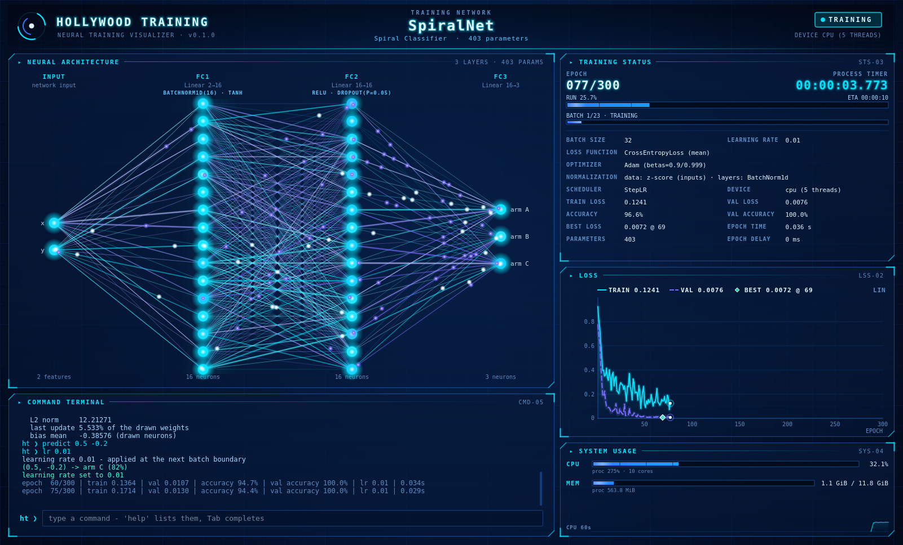

# Hollywood Training

**Watch PyTorch networks train in a Hollywood-style native GUI.** Keep your training code
exactly as you write it today. Add a decorator and wrap your step function, and a blue
HUD window shows the real network, its real weights changing every epoch, live loss
curves, the full training status, system usage, and a command terminal that controls
the run.



* **Real, synchronised:** the window is updated after **every** epoch, and the next
  epoch starts only once that update has been drawn. No artificial delays are added.
* **Native PyTorch:** your model class, optimizer, loss and `DataLoader`s stay as they
  are. Nothing inspects or rewrites your code.
* **Native window:** a Qt 6 (PySide6) desktop window, not a web page. It runs in its own
  process, so drawing never slows training down.
* **Controllable:** `pause`, `step 5`, `lr 0.001`, `epochs 500`, `save model.pt`, and
  your own custom commands, typed into the window's terminal.

## Installation

Requires Python 3.10+. Install PyTorch for your platform first (CPU or GPU build), as
described at [pytorch.org](https://pytorch.org/get-started/locally/). Then, from the
project folder:

```bash
pip install .                 # or: pip install -e ".[dev]" for development
pip install ".[gpu]"          # optional: GPU utilisation readings on NVIDIA hardware
```

Dependencies: `torch>=2.0`, `numpy`, `PySide6-Essentials>=6.5` and `psutil`.

## Quick start

```python
import torch
from torch import nn
from torch.utils.data import DataLoader, TensorDataset

import hollywood_training as ht


@ht.track                                  # 1. track the network
class Net(nn.Module):
    def __init__(self):
        super().__init__()
        self.fc1 = nn.Linear(2, 16)
        self.act = nn.Tanh()
        self.fc2 = nn.Linear(16, 2)

    def forward(self, x):
        return self.fc2(self.act(self.fc1(x)))


x = torch.randn(512, 2)
y = (x[:, 0] * x[:, 1] > 0).long()
loader = DataLoader(TensorDataset(x, y), batch_size=32, shuffle=True)

model = Net()
optimizer = torch.optim.Adam(model.parameters(), lr=0.01)
loss_fn = nn.CrossEntropyLoss()

process = ht.TrainingProcess(model, optimizer, loader, loss_fn=loss_fn, epochs=100)


@process.train_step                        # 2. wrap your native training step
def train_step(batch):
    inputs, targets = batch
    optimizer.zero_grad()
    loss = loss_fn(model(inputs), targets)
    loss.backward()
    optimizer.step()
    return loss


if __name__ == "__main__":
    result = ht.run(process)               # 3. hand it to the manager
    print(result.train_losses[-1])
```

`ht.run(process)` opens the window, trains, and returns a `TrainingResult` (the
per-epoch history) once you close the window. Errors in your step functions are shown
in the terminal, and then raised from `run()` as `ht.TrainingFailedError`, with your
exception as its `__cause__`.

### Ways to describe the training

* **Step decorators:** `@process.train_step`, `@process.validation_step`,
  `@process.on_epoch_end` (any number) and `@process.command(...)`.
* **Constructor arguments:** pass plain functions,
  `ht.TrainingProcess(..., train_step=fn, validation_step=fn2, on_epoch_end=hook)`.
* **Default steps:** omit the steps entirely. With `loss_fn` and `(inputs, targets)`
  batches, the textbook supervised steps are used.

A step returns the batch loss, or a dict with `"loss"` plus extra metrics, e.g.
`{"loss": loss, "accuracy": acc}`. Metrics appear in the status panel and the history.
Validation runs under `model.eval()` and `torch.no_grad()`.

The network can be tracked in two ways: `@ht.track` / `@ht.track(name=..., input_labels=...,
output_labels=...)` on your class, or `ht.track(model_instance, ...)` for models you
didn't define yourself, such as `nn.Sequential`. Untracked models passed to `run()` are
tracked with default settings.

## The window

| Panel | Shows |
|---|---|
| Header | the network's **class name**, display name, parameter count, state, device |
| Neural architecture | neurons and connections of every layer, drawn from the **real weights** (cyan positive, indigo negative, brightness by magnitude, white-hot for the biggest last-epoch changes), neuron bias, activation / normalisation badges, signals flowing along strong weights |
| Training status | current / total epoch, progress bars, **process timer**, ETA, batch size, learning rate, loss function, optimizer, normalisation strategy, scheduler, device, losses, metrics, best epoch |
| Loss | training and validation loss, extended after every epoch (`scale` or a click: log scale) |
| System usage | CPU and memory of the machine and the process, plus GPU when training runs on one |
| Command terminal | the commands below, with history (↑/↓), Tab completion and PgUp/PgDn (Ctrl+Home/End) to scroll the log; everything you type in the window goes here |

Wide layers are sampled: at most `max_neurons` (default 20) neurons are drawn per
column, and statistics always cover the full tensors.

## Commands

| Command | Effect |
|---|---|
| `help [command]` | list all commands, or explain one |
| `status` | state, epoch, losses, learning rate, timer, ETA |
| `pause` / `resume` | pause at the next batch boundary / continue |
| `step [n]` | run `n` more epochs (default 1), then pause |
| `stop` | end training (the window stays open) |
| `epochs <n>` | change the total; also continues a finished run |
| `lr <value>` | set the learning rate of every parameter group |
| `delay <ms>` | wait after every epoch (`delay 0` = full speed) |
| `history [n]` · `arch` · `weights [layer]` | inspect epochs, architecture, weights |
| `scale [lin\|log]` | loss chart axis: linear or logarithmic (switches without an argument) |
| `save <path>` | `torch.save(model.state_dict(), path)` |
| `screenshot [path]` · `clear` · `quit` | save a PNG of the window · clear the terminal · stop and close |

Commands that touch the model or optimizer run on the training thread between batches,
never in the middle of an optimisation step. Add your own:

```python
@process.command("norm", summary="L2 norm of a layer's weights", arguments=[ht.Argument("layer")])
def norm(context, layer):
    def measure(target):  # runs on the training thread, between batches
        return f"|{layer}| = {getattr(target.model, layer).weight.norm():.4f}"

    return context.submit(measure, f"norm of {layer}")
```

The spiral demo's `predict x y` command is a complete example that queries the live model.

## `run()` options

| Option | Default | Meaning |
|---|---|---|
| `gui` | `True` | `False` prints to the console instead (servers, CI) |
| `isolate_gui` | `True` | the window runs in its own process; `False` keeps it in-process (e.g. inside an existing Qt app) |
| `start_paused` | `False` | open paused to inspect the initial network; type `resume` |
| `close_on_finish` | `False` | close the window by itself at the end |
| `max_neurons` | `20` | neurons drawn per layer column |
| `torch_threads` | `"auto"` | while the window is open, cap PyTorch's CPU threads at half the cores (see below); `None` keeps yours |
| `title` / `log_every` | `None` | window title / console line frequency |

## Demos

```bash
python demos/spiral_classifier.py        # 3-arm spiral, MLP with BatchNorm + Dropout
python demos/sine_regression.py          # nn.Sequential learns sin(x)
python demos/spiral_classifier.py --no-gui --epochs 50
```

See [demos/README.md](demos/README.md) for options, and things to try in the terminal.

## Performance notes

Training runs on your thread, at the speed the per-epoch synchronisation allows. The
cost per epoch is one full redraw of the network and chart, about 10 to 15 ms in the
window process.

PyTorch's CPU thread pool uses spin-waiting workers on *every* core by default. While
any other work runs on the machine, such as the window drawing, that pool can stall
badly. Small-batch CPU training was measured up to 9× slower. `run()` therefore caps the
pool at half the cores while a window is open, and restores your setting afterwards.
For the best speed, start Python with the pool already sized, for example on Linux and
macOS:

```bash
OMP_NUM_THREADS=4 python train.py
```

GPU training is unaffected. Details: [wiki/Performance](wiki/Performance.md).

## Platforms

Linux (X11 or Wayland), macOS and Windows: anywhere PySide6 and PyTorch run. Without a
display, use `gui=False`, or set `QT_QPA_PLATFORM=offscreen` to render without a screen.
On Linux, Qt needs a few system libraries (for X11, notably `libxcb-cursor0`); see
[wiki/Troubleshooting](wiki/Troubleshooting.md).

## Documentation

The [`wiki/`](wiki/Home.md) folder documents every module and the overall architecture.
It's written for the GitHub wiki: copy the folder's content into the repository's
`*.wiki.git` to publish it. Start with [Architecture](wiki/Architecture.md).

## Development

```bash
pip install -e ".[dev]"
pytest                      # 99 tests; GUI tests run headless (Qt "offscreen")
ruff check . && ruff format --check .
```

Project layout:

```
hollywood_training/   the package: tracking · training · sync · commands · monitor · gui
demos/                runnable demos with synthetic data
tests/                pytest suite (core, GUI, demos)
wiki/                 GitHub-wiki pages: one per module + architecture and guides
```
