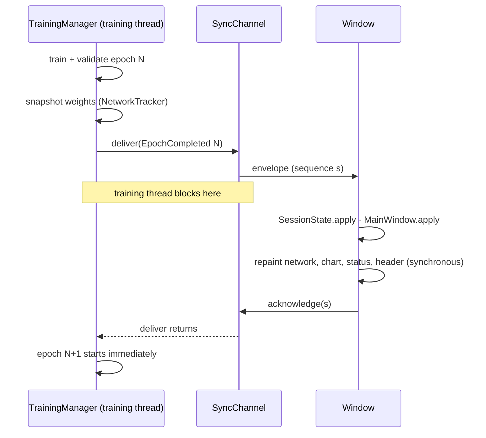

# Architecture

Hollywood Training is split into layers that depend only downward. Only the `gui`
layer knows about Qt, and only the training side knows about torch. The window can
therefore run in a separate, light process, and the training core can be tested
without a display.

```
             user script (plain PyTorch)
                        │  @track · TrainingProcess · run()
┌───────────────────────▼──────────────────────────────────────────────────────┐
│ runner        run(): wires a process, the manager and a frontend             │
├───────────────┬───────────────────────────────┬──────────────────────────────┤
│ training      │ commands                      │ frontends                    │
│  process      │  registry · context · builtin │  gui (window process or      │
│  manager      │  view (window-only requests)  │       in-process window)     │
│  steps …      │                               │  console                     │
├───────────────┴───────────────┬───────────────┴──────────────────────────────┤
│ sync   events · channel · control · pump · session                           │
├───────────────────────────────┴──────────────────────────────────────────────┤
│ tracking   decorator · inspector · tracker · snapshot   (data: architecture, │
│            roles, weights - torch-free)                                      │
│ monitor    system · gpu   (data: usage - torch-free)        formatting       │
└──────────────────────────────────────────────────────────────────────────────┘
```

| Layer | Package | Responsibility | Pages |
|---|---|---|---|
| Tracking | `hollywood_training.tracking` | What the network is (architecture) and what its weights are (per-epoch snapshots) | [Tracking](Tracking) |
| Synchronization | `hollywood_training.sync` | The contract between training and a frontend: events, the blocking hand-off, runtime control, frontend-side state | [Synchronization](Synchronization) |
| Training | `hollywood_training.training` | The user-defined process and the manager that runs it | [Training](Training) |
| Commands | `hollywood_training.commands` | The runtime command language typed in the terminal | [Commands](Commands) |
| Monitoring | `hollywood_training.monitor` | CPU / memory / GPU usage | [Monitoring](Monitoring) |
| GUI | `hollywood_training.gui` | The native window, in its own process by default | [GUI](GUI) |
| Console | `hollywood_training.console` | Text frontend for machines without a display | [Console Frontend](Console-Frontend) |
| Runner | `hollywood_training.runner` | `run()`, the management method | [Runner](Runner) |

## Processes and threads

By default a session uses **two processes**:

```
 training process (your Python)                          window process
 ───────────────────────────────                         ───────────────────────────────
 main thread:  TrainingManager.run()                     main thread:  Qt event loop
   └ your train_step / validation_step                     └ MainWindow (draws, animates)
   └ SyncChannel.deliver ── ("event", Envelope) ─────────▶  apply → draw → ("ack", seq)
                         ◀──────────── ("ack", seq) ─────┘
 link thread:  receives acks + command lines ◀─ ("command", line) ── terminal input
               runs commands, replies ("result", …) ──────────────▶ terminal output
 usage thread: SystemMonitor.sample() ── ("usage", sample) ───────▶ usage panel
```

* Training runs on **your** thread, unchanged. PyTorch keeps the thread that created
  your data and model, and no drawing happens between batches.
* The window process imports no torch. It receives plain data (frozen slot
  dataclasses and numpy arrays) over an authenticated local socket (a named pipe on
  Windows). See [GUI Link Protocol](GUI-Link-Protocol).
* With `run(process, isolate_gui=False)` the window instead lives inside the training
  process. Training and drawing then share the main thread through an
  [event pump](Sync-Event-Pump). See [GUI In-Process Frontend](GUI-In-Process-Frontend).
* With `run(process, gui=False)` the [console frontend](Console-Frontend) prints
  instead.

## The epoch hand-off

The SPEC requires the GUI to be updated at **every** epoch, and the update to be
**complete before the next epoch** starts. Four events are therefore *synchronous*:
`SessionStarted`, `EpochCompleted`, `TrainingPaused` and `SessionFinished`.



* Acknowledgement happens only after the affected panels have been **repainted**, so
  the guarantee holds by construction, not by timing.
* No artificial delay is added: the next epoch starts the moment the window has drawn
  this one (SPEC 6). The `delay <ms>` command adds a pause on request.
* Everything else (`BatchProgress`, `StateChanged`, `LogMessage`) is sent without
  waiting.

Details: [Sync Events](Sync-Events), [Sync Channel](Sync-Channel),
[Training Manager](Training-Manager).

## Control flowing back

Commands never touch training state directly. They change flags on
[`TrainingControl`](Sync-Control): pause, resume, step, stop, total epochs, delay. Or
they queue *actions*, such as setting the learning rate or saving weights, which the
manager runs on the training thread at the next batch boundary. That is why a command
can never race with an optimizer step. See [Commands](Commands).

## Data contract

Everything a frontend receives is immutable plain data with no references to modules
or tensors:

| Data | Module | Produced by |
|---|---|---|
| `ArchitectureInfo`, `LayerInfo`, `OperationInfo` | `tracking.architecture` | `NetworkArchitecture.describe()` |
| `WeightSnapshot`, `LayerWeights`, `WeightStats` | `tracking.weights` | `NetworkTracker.snapshot()` |
| `SessionInfo`, `EpochRecord`, events | `sync.events` | `TrainingManager` |
| `UsageSample`, `GpuUsage` | `monitor.usage` | `SystemMonitor.sample()` |

These modules import no torch. The package `__init__` files export torch-dependent
names lazily (PEP 562), so the window process can unpickle events without loading
PyTorch.

## How the SPEC maps to the code

| SPEC requirement | Where |
|---|---|
| 1 automatic architecture and weight tracking (decorator / slot dataclasses) | [Tracking Decorator](Tracking-Decorator), [Tracking Architecture Model](Tracking-Architecture-Model), [Tracking Network Tracker](Tracking-Network-Tracker) |
| 2 native training steps wrapped into an object passed to a manager | [Training Process](Training-Process), [Runner](Runner), [Training Manager](Training-Manager) |
| 3 native PyTorch workflow unchanged | decorator returns the class unchanged; steps are plain functions |
| 4 native window, smooth animations | [GUI](GUI), [GUI Animation](GUI-Animation) |
| 5 GUI updated at every epoch, complete before the next | [Sync Channel](Sync-Channel), the hand-off above |
| 6 as fast as synchronisation allows | no delays; [Performance](Performance) |
| 7 runtime commands | [Commands](Commands), [GUI Terminal](GUI-Terminal) |
| 8 no "dark magic" | only public PyTorch APIs: `named_modules`, forward hooks, `optimizer.param_groups`, `DataLoader.batch_size`, `type(...).__name__`; user code is never inspected |
| 9 decomposed modules | one module per concern (this page) |
| 10 package files in `hollywood_training/` | yes |
| 11 demos in `demos/` | [Demos](Demos) |
| 12 README | `README.md` |
| 13 wiki | this folder |
