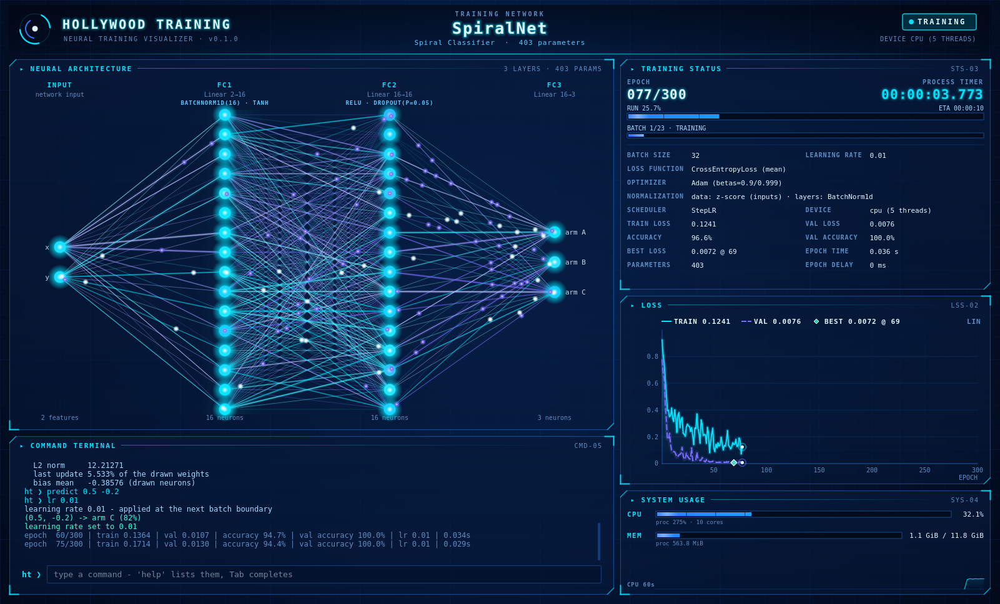

# GUI

`hollywood_training/gui/` · package overview · see also [Architecture](Architecture)

The `gui` package is the native desktop frontend: a Qt 6 (PySide6) window in a blue HUD
style. It shows the tracked network with its real weights, the training status, the loss
curves, system usage and a command terminal. Every synchronous event (session start,
each epoch, pause, finish) is drawn completely before the training thread continues. By
default the window runs in its own process. `run(process, isolate_gui=False)` keeps it
in the training process instead.



## Window layout

```
┌──────────────────────────────────────────────────────────────────────────────┐
│ HeaderBar: emblem · HOLLYWOOD TRAINING · NETWORK CLASS NAME · state · device │
├──────────────────────────────────────────────┬───────────────────────────────┤
│ NetworkView - NEURAL ARCHITECTURE            │ StatusPanel - TRAINING STATUS │
│   one column of neurons per feature vector   │   EPOCH n/N     PROCESS TIMER │
│   (input, then every connection layer);      │   RUN bar, BATCH bar, ETA     │
│   lines drawn from the real weights:         │   settings, losses, metrics   │
│   cyan +, indigo -, white-hot = changed most │                          44 % │
│   neurons tinted by bias, signal particles   ├───────────────────────────────┤
│                                              │ LossChart - LOSS              │
│                                              │   train (cyan), val (indigo)  │
│                                        70 %  │   best epoch, scale: lin/log  │
├──────────────────────────────────────────────┤                          36 % │
│ TerminalPanel - COMMAND TERMINAL             ├───────────────────────────────┤
│   log output (epochs, states, results)       │ UsagePanel - SYSTEM USAGE     │
│   ht > command line, history, Tab      30 %  │   CPU, MEM, GPU, VRAM    20 % │
└──────────────────────────────────────────────┴───────────────────────────────┘
                     62 %                                   38 %
```

The percentages are the initial splitter shares. The `layout` command changes them
(`layout chart 50`, `layout reset`). Panels cannot be collapsed. Every panel except the header is a [HUD Panel](GUI-HUD-Panel).
Details: [Main Window](GUI-Main-Window).

## Keyboard-driven control

The window is driven entirely from the keyboard (specification R2). While it is the
active window, every key goes to the [terminal](GUI-Terminal)'s command line
([Keyboard Focus](GUI-Keyboard-Focus)): no click is needed, and no other widget can take
the focus. Inside the window there is no mouse pointer and no pointer input has any effect
([Pointer Guard](GUI-Pointer-Guard)). Both are per window: other applications, other
windows of the same `QApplication`, and the native title bar keep their mouse and pointer.

What the mouse did in the first version is a command or a terminal key now. The commands
are listed under `VIEW` in `help`; they change only the window and reach it as
[View Requests](Commands-View), carried out by [View Actions](GUI-View-Actions):

| First version (mouse) | Now (keyboard) |
|---|---|
| click the loss chart: linear / log axis | `scale [lin\|log]` |
| hover the loss chart: an epoch's values | `probe [epoch\|off]`: the values, and the probe line on the chart, removed when training continues |
| hover a neuron: index, label, bias | `neuron [column] [index]`, `neuron off` |
| drag a splitter | `layout [panel] [percent]`, `layout reset` |
| wheel / scroll bar on the log | PgUp / PgDn, Ctrl+Home / Ctrl+End |
| select and copy log text | `copy [lines]` |
| title bar buttons (still there) | `window [normal\|max\|full\|min]`, `quit` |

## What each panel shows

How the SPEC's "GUI Layout" requirements map to the panels:

| SPEC | Requirement | Panel | How it is met |
|---|---|---|---|
| 1 | architecture, connections between neurons, real weights changing every epoch | [Network View](GUI-Network-View) | one line per drawn weight of each layer's real connection matrix: cyan positive, indigo negative, width and opacity by magnitude, white-hot for the largest changes of the last epoch; neurons tinted by bias; rebuilt from the new snapshot at every epoch hand-off |
| 2 | total and current epoch, batch size, learning rate, loss function, optimizer, normalization strategy, progress bar, process timer | [Status Panel](GUI-Status-Panel) | `EPOCH 077/300` counter, `PROCESS TIMER`, `RUN` (epochs) and `BATCH` progress bars, ETA, rows `BATCH SIZE`, `LEARNING RATE`, `LOSS FUNCTION`, `OPTIMIZER`, `NORMALIZATION`, plus scheduler, device, losses, metrics, best epoch, epoch time, parameters, epoch delay |
| 3 | training and validation loss, drawn dynamically every epoch | [Loss Chart](GUI-Loss-Chart) | cyan training curve over a filled area, dashed indigo validation curve, both extended at each `EpochCompleted`; the x axis spans all requested epochs |
| 4 | memory, CPU and GPU usage (GPU when applicable) | [Usage Panel](GUI-Usage-Panel) | `CPU` and `MEM` rows for the machine and the training process; `GPU` / `VRAM` rows only when the reading contains a GPU; a 60 s CPU sparkline |
| 5 | integrated terminal for the runtime commands | [Terminal](GUI-Terminal) | command line with history (Up / Down) and Tab completion; every key typed in the window goes there ([Keyboard Focus](GUI-Keyboard-Focus)); lines run in the training process through the [command registry](Commands) |
| 6 | the network's class name | [Header](GUI-Header) | `SessionInfo.network_class` in large glowing letters under `TRAINING NETWORK`; also in the window title and the terminal banner |
| 7 | blue based | [Theme](GUI-Theme) | `Palette`: blue and cyan tones, indigo for negative values, plus status accents |

SPEC requirement 4 (native window, smooth animations) is met by Qt widgets and one
60 fps [animation clock](GUI-Animation). Requirement 5 (update complete before the next
epoch) is met by `MainWindow.render_now()`. It repaints the affected panels synchronously,
before each synchronous event is acknowledged ([Architecture](Architecture)).

Data flows one way through the window. The frontend folds each event into a
[`SessionState`](Sync-Session-State), then calls `MainWindow.apply(event)`. The header,
network view, status panel and loss chart read that state whenever they paint.

## Two frontends

Both frontends implement the commands' `FrontendActions` (`clear_output`, `close`,
`screenshot`, and `view` for the window-only commands, see [View Requests](Commands-View)) and call `ensure_display()` first. Both keep the window open after training
until it is closed, unless `close_on_finish=True` (then it closes 400 ms after the end).
Closing the window stops training.

| | [Remote Frontend](GUI-Remote-Frontend) (default) | [In-Process Frontend](GUI-In-Process-Frontend) |
|---|---|---|
| Selected by | `run(process)` | `run(process, isolate_gui=False)` |
| Class | `RemoteFrontend` (`gui/remote.py`) | `QtFrontend` (`gui/app.py`) |
| Window lives in | a child process, `python -m hollywood_training.gui.window_process` ([Window Process](GUI-Window-Process)) | the training process |
| Training thread | never draws; sends events over the [link](GUI-Link-Protocol) and waits for `("ack", sequence)` | pumps Qt through `QtPump` between batches; the channel sink applies, draws and acknowledges directly |
| Commands run on | a dedicated command thread of the training process | the main thread, from the window's signal |
| Usage readings | sampled every 0.5 s on a helper thread, pushed with `UsagePanel.set_sample` | pulled twice a second with `UsagePanel.set_sampler` |
| During one long batch | the window keeps animating | the window refreshes when the batch ends |
| Thread check | none | `run()` raises `RuntimeError` off the main thread |

## Rendering strategy

The backdrop, the header, the network view and the loss chart split their drawing in
two. The **static layer** is rendered into a cached pixmap and rebuilt only when its
inputs change. Every cache key also contains the widget size and the device pixel ratio
(DPR). The **overlay** is drawn on top of that pixmap at every frame. The status and
usage panels redraw completely each frame.

| Widget | Cached | Rebuilt when | Drawn every frame |
|---|---|---|---|
| `Backdrop` | gradient, grid | size or DPR changes | (nothing) |
| [Header](GUI-Header) | title, class name, display name, parameters | name, display name, parameter count, size, DPR | emblem, state badge, device |
| [Network View](GUI-Network-View) | frame, connections, neurons, labels | `architecture_version`, `weights_version`, size, DPR | neuron halos, signal particles, scanning band |
| [Loss Chart](GUI-Loss-Chart) | frame, grid, ticks, curves, best marker, legend | `history_version`, `total_epochs`, lin/log, size, DPR | pulsing newest-point markers, probe line |
| [Status Panel](GUI-Status-Panel), [Usage Panel](GUI-Usage-Panel) | glowing digits only (sprites) | (per character) | the whole panel |

* **One clock.** `MainWindow` owns a single `AnimationClock` (60 fps). Each animated
  panel advances its own time on `tick(dt)` and calls `update()`, which Qt coalesces.
* **The hand-off repaints and does not wait for a frame.** For synchronous events,
  `MainWindow.render_now()` calls `repaint()` on the header, network view, status panel
  and loss chart. Caches whose version changed are rebuilt inside that call, and only
  then does the frontend acknowledge. `NetworkView.last_painted_epoch` and
  `LossChart.last_painted_epoch` record what was actually painted.
* **Cheap primitives.** Connections are 1 px lines on Qt's fast path, with thickness
  from parallel offset lines. Glowing digits and glow dots come from `lru_cache`d sprites
  ([Theme](GUI-Theme)). Measurements are on the [Performance](Performance) page.

## Package exports

```python
from hollywood_training.gui import AnimationClock, MainWindow   # imported with the package
from hollywood_training.gui import RemoteFrontend, QtFrontend   # imported on first access
```

| Name | Module | Loaded |
|---|---|---|
| `AnimationClock` | `gui.animation` | when `hollywood_training.gui` is imported |
| `MainWindow` | `gui.window` | when `hollywood_training.gui` is imported |
| `QtFrontend`, `QtPump`, `ensure_display` | `gui.app` | on first attribute access (PEP 562 `__getattr__`) |
| `RemoteFrontend` | `gui.remote` | on first attribute access |
| `WindowProcess` | `gui.window_process` | on first attribute access |

The frontend modules need the training side (commands, `SystemMonitor`,
`TrainingManager`), and with it torch. Loading them lazily keeps the window process
torch-free: `gui.window_process` needs only `MainWindow`, the sync data classes and numpy.
An unknown name raises `AttributeError`, and `__dir__()` returns the sorted `__all__`.
Importing `hollywood_training.gui` loads PySide6. `import hollywood_training` does not
import the GUI at all.

`hollywood_training.gui.widgets` exports the panels and their helpers: `HeaderBar`,
`HudPanel`, `paint_bar`, `NetworkView`, `Column`, `Link`, `Signals`, `build_columns`,
`LossChart`, `Axes`, `nice_ticks`, `decade_ticks`, `StatusPanel`, `TerminalPanel`,
`CommandLine` and `UsagePanel`.

## Modules

| Module | Page | Contents |
|---|---|---|
| `gui/window.py` | [Main Window](GUI-Main-Window) | `MainWindow`, `Backdrop`: layout, event routing, synchronous repaint |
| `gui/keyboard_focus.py` | [Keyboard Focus](GUI-Keyboard-Focus) | `KeyboardFocus`: every key typed in the active window goes to the command line |
| `gui/pointer_guard.py` | [Pointer Guard](GUI-Pointer-Guard) | `PointerGuard`: no mouse pointer and no pointer input inside the window |
| `gui/view_actions.py` | [View Actions](GUI-View-Actions) | `ViewActions`: what the window-only commands do in the window |
| `gui/remote.py` | [Remote Frontend](GUI-Remote-Frontend) | `RemoteFrontend`: the default frontend, training-process side |
| `gui/window_process.py` | [Window Process](GUI-Window-Process) | the child process: `WindowProcess`, `main()` |
| `gui/link.py` | [Link Protocol](GUI-Link-Protocol) | `Link` and the message tuples in both directions |
| `gui/app.py` | [In-Process Frontend](GUI-In-Process-Frontend) | `QtFrontend`, `QtPump`, `ensure_display()` |
| `gui/theme.py` | [Theme](GUI-Theme) | palette, fonts, stylesheet, glow helpers, app icon |
| `gui/animation.py` | [Animation](GUI-Animation) | `AnimationClock`, `approach`, `pulse` |
| `gui/widgets/hud.py` | [HUD Panel](GUI-HUD-Panel) | `HudPanel` base frame, `paint_bar` |
| `gui/widgets/header.py` | [Header](GUI-Header) | `HeaderBar` |
| `gui/widgets/network_view.py` | [Network View](GUI-Network-View) | `NetworkView`, `build_columns`, `Signals` |
| `gui/widgets/loss_chart.py` | [Loss Chart](GUI-Loss-Chart) | `LossChart`, `Axes`, `nice_ticks`, `decade_ticks` |
| `gui/widgets/status_panel.py` | [Status Panel](GUI-Status-Panel) | `StatusPanel` |
| `gui/widgets/usage_panel.py` | [Usage Panel](GUI-Usage-Panel) | `UsagePanel` |
| `gui/widgets/terminal.py` | [Terminal](GUI-Terminal) | `TerminalPanel`, `CommandLine` |

Without a display, `QT_QPA_PLATFORM=offscreen` renders the window off screen (the GUI
tests run that way). Platform issues are covered on the [Troubleshooting](Troubleshooting)
page.
