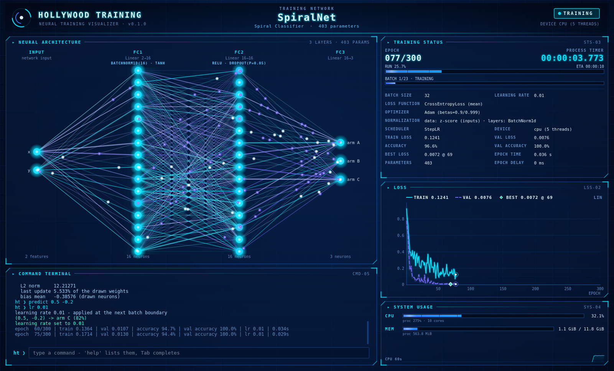

# Hollywood Training

Watch PyTorch networks train in a Hollywood-style native GUI. The real network, its
real weights changing after every epoch, live loss curves, the complete training
status, system usage and a command terminal. The window is driven entirely from the
keyboard, and your training code stays plain PyTorch.



```python
import hollywood_training as ht

@ht.track                                     # track the network
class Net(nn.Module): ...

process = ht.TrainingProcess(model, optimizer, train_loader,
                             loss_fn=loss_fn, val_data=val_loader, epochs=100)

@process.train_step                           # wrap your native training step
def train_step(batch): ...

ht.run(process)                               # hand it to the manager
```

## Start here

| Page | For |
|---|---|
| [Getting Started](Getting-Started) | installation, a first run, the three steps in detail |
| [Architecture](Architecture) | how the package is put together: layers, processes, the epoch hand-off |
| [Demos](Demos) | the two demos and what to try in them |
| [Commands](Commands) | every terminal command, and how to add your own |
| [Performance](Performance) | what synchronisation costs, and PyTorch's CPU threads |
| [Troubleshooting](Troubleshooting) | display, Qt and platform issues |
| [Development](Development) | tests, linting, the wiki itself |
| [API Reference](API-Reference) | everything `import hollywood_training` exposes |

## Components

| Subsystem | What it does |
|---|---|
| [Tracking](Tracking) | discovers the architecture of a network and snapshots its weights every epoch |
| [Training](Training) | `TrainingProcess` (your steps, wrapped) and `TrainingManager` (runs them) |
| [Synchronization](Synchronization) | events, the blocking epoch hand-off, runtime control, frontend state |
| [Commands](Commands) | the runtime command language |
| [Monitoring](Monitoring) | CPU, memory and GPU usage |
| [GUI](GUI) | the native window and its panels |
| [Console Frontend](Console-Frontend) | text output for machines without a display |
| [Runner](Runner) | `run()`, which wires it all together |

Every module has its own page. The sidebar lists them all.
