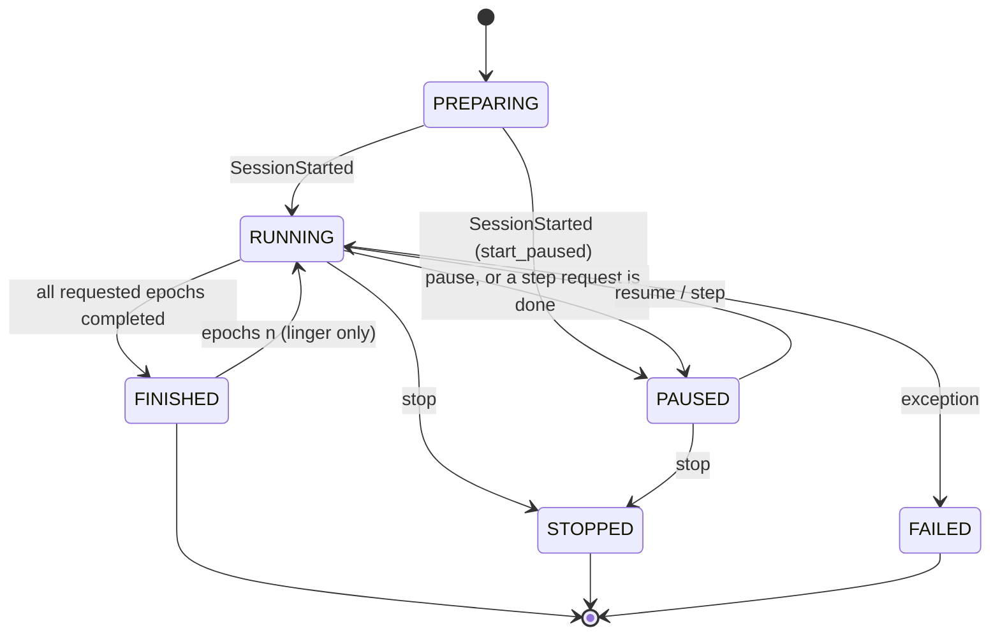

# Training

`hollywood_training/training/` · part of [Architecture](Architecture)

The training package holds the user-defined process and the manager that runs it. You
write the training of one batch in plain PyTorch and wrap it in a `TrainingProcess`.
[`run()`](Runner) then hands it to a `TrainingManager`, which runs the epochs on your
thread in lock-step with a frontend. User code is only stored and called, never
inspected. What the GUI shows about the run is read from public PyTorch attributes or
from values passed to `TrainingProcess`.

## Lifecycle of a run

1. **Wrap.** `TrainingProcess(model, optimizer, train_data, epochs=..., ...)` validates
   the components. Steps, epoch hooks and custom commands are registered through
   constructor arguments or decorators. See [Training Process](Training-Process).
2. **Resolve.** `run()` calls `process.resolve_steps()` before anything starts. A
   missing step falls back to the default supervised step
   ([Training Steps](Training-Steps)), or raises `ProcessError`.
3. **Wire.** `run()` creates `TrainingControl`, `SyncChannel`, `NetworkTracker`, the
   command registry and a frontend, then calls `TrainingManager.run()`. See
   [Runner](Runner).
4. **Start.** The manager builds the `SessionInfo`
   ([Training Descriptions](Training-Descriptions)), snapshots the initial weights and
   delivers `SessionStarted`.
5. **Epochs.** Each epoch runs the train steps, the validation steps, the scheduler step
   and the `on_epoch_end` hooks. The manager then takes a weight snapshot and hands
   `EpochCompleted` to the frontend, blocking until it is drawn. Between batches the
   manager pumps the frontend and applies control requests. See
   [Training Manager](Training-Manager).
6. **End.** After the last epoch the manager either ends the session or lingers until
   `epochs <n>` or `stop`. It delivers `SessionFinished` and builds a `TrainingResult`
   ([Training Results](Training-Results)). Its `elapsed` time comes from an
   [`ActiveClock`](Training-Active-Clock), which excludes pauses.
7. **Return.** `run()` returns the result. If the session ended `FAILED`, it raises
   `TrainingFailedError` instead.



The states are `TrainingState` values ([Sync Events](Sync-Events)). A stop that arrives
after all requested epochs have completed, for example while lingering, ends the session
as `FINISHED`, not `STOPPED`. A `step` request that ends on the last epoch finishes the
run instead of pausing.

## Modules

| Module | Page | Contents |
|---|---|---|
| `process.py` | [Training Process](Training-Process) | `TrainingProcess`, `ProcessSteps`, `ProcessError`, `EpochHook` |
| `steps.py` | [Training Steps](Training-Steps) | the step contract, `read_step_output`, `StepResult`, default supervised steps |
| `manager.py` | [Training Manager](Training-Manager) | `TrainingManager` (the epoch loop), `TrainingError` |
| `describe.py` | [Training Descriptions](Training-Descriptions) | text descriptions of loss, optimizer, device, ...; `SessionInfo` |
| `history.py` | [Training Results](Training-Results) | `TrainingResult` |
| `timing.py` | [Training Active Clock](Training-Active-Clock) | `ActiveClock`, a pausable stopwatch |

The entry point `run()` is in `hollywood_training/runner.py`; see [Runner](Runner).

## Package exports

`hollywood_training/training/__init__.py` re-exports these names:

| Names | From |
|---|---|
| `TrainingProcess`, `ProcessSteps`, `ProcessError`, `EpochHook` | `process.py` |
| `StepFunction`, `StepResult`, `StepOutputError`, `read_step_output`, `infer_batch_size`, `supervised_train_step`, `supervised_validation_step` | `steps.py` |
| `TrainingManager`, `TrainingError` | `manager.py` |
| `current_learning_rate`, `describe_loss`, `describe_normalization`, `describe_optimizer`, `model_device` | `describe.py` |
| `TrainingResult` | `history.py` |
| `ActiveClock` | `timing.py` |
| `EpochRecord` | `hollywood_training.sync.events` |

The top-level package also exposes `TrainingProcess`, `TrainingResult` and
`ProcessError` (loaded on first access, see [API Reference](API-Reference)). Importing
`hollywood_training.training` imports torch.

## Example

```python
import hollywood_training as ht

process = ht.TrainingProcess(model, optimizer, train_loader,
                             loss_fn=loss_fn, val_data=val_loader, epochs=100)

@process.train_step
def train_step(batch):
    inputs, targets = batch
    optimizer.zero_grad()
    loss = loss_fn(model(inputs), targets)
    loss.backward()
    optimizer.step()
    return loss

result = ht.run(process)    # validation uses the default supervised step
print(result.state.value, result.epochs_completed, result.best_epoch())
```
